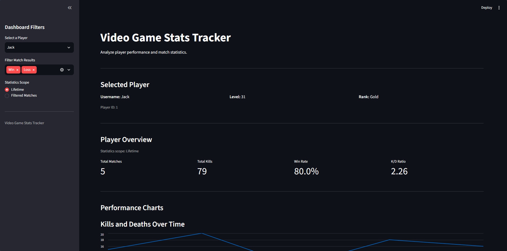

# Video Game Stats Tracker

A Python-based video game statistics tracking application that uses SQLite for data storage and Streamlit for interactive analytics.

The project allows users to manage player profiles, record match results, analyze gameplay performance, and visualize statistics through both a command-line interface and a web dashboard.

## Features

### Player Management
- Add and manage player profiles.
- Store usernames, player levels, and ranks.
- Retrieve player information from a SQLite database.

### Match Tracking
- Record match results, including kills, deaths, and wins or losses.
- Maintain a persistent history of matches for each player.
- Automatically calculate performance statistics.

### Player Analytics
- View total matches played, kills, and deaths.
- Calculate win rates and kill/death (K/D) ratios.
- View player statistics and match history.
- Handle players with no matches or zero deaths.

### Streamlit Dashboard
- Select players using an interactive sidebar.
- Filter match history by wins and losses.
- Switch between lifetime and filtered statistics.
- Visualize kills and deaths over time.
- Analyze win/loss distributions and kills per match.
- View match history in an interactive table.
- Export filtered match history as a CSV file.

### Testing
- Automated unit tests using Python's unittest framework.
- Database tests use an in-memory SQLite database.
- Tests cover database operations and statistical calculations.
- Additional tests validate dashboard filtering and edge cases.

## Technologies Used

| Technology | Purpose |
|------------|---------|
| Python | Application logic |
| SQLite | Relational database |
| SQL | Database queries and aggregation |
| Streamlit | Interactive web dashboard |
| Pandas | Data processing and visualization preparation |
| unittest | Automated testing |
| Git | Version control |
| GitHub | Source code hosting |

## Project Structure

```text
video-game-stats-tracker/
|
|-- main.py
|-- database.py
|-- dashboard.py
|-- dashboard_utils.py
|-- game_stats.db          # Local database (not tracked by Git)
|-- requirements.txt
|-- README.md
|-- .gitignore
|
|-- tests/
|   |-- __init__.py
|   |-- test_dashboard_utils.py
|   |-- ... other existing test files
|
|-- assets/
    |-- screenshots/
        |-- main-menu.png
        |-- leaderboard.png
        |-- player-stats.png
        |-- dashboard.png
```

## Installation

### 1. Clone the Repository

```bash
git clone https://github.com/jacka26/video-game-stats-tracker.git
cd video-game-stats-tracker
```

### 2. Install Dependencies

Make sure Python 3 is installed.

Install the required packages:

```bash
py -m pip install -r requirements.txt
```

### 3. Run the Command-Line Application

```bash
py main.py
```

The command-line interface allows users to create player profiles, record matches, and view statistics.

### 4. Run the Streamlit Dashboard

```bash
py -m streamlit run dashboard.py
```

Streamlit will open the dashboard in your browser, typically at:

http://localhost:8501

Both interfaces use the same local SQLite database.

**Note:** The dashboard requires at least one player. Use the command-line application to create a player and record matches before exploring the dashboard.

## Screenshots

### Command-Line Interface

**Main Menu**


**Leaderboard**


**Player Statistics**


### Streamlit Analytics Dashboard



The dashboard displays player statistics, interactive performance charts, and filtered match history.

## How It Works

### Database

The application uses a relational SQLite database containing two primary tables.

**Players Table**

Stores player information:

- player_id
- username
- level
- rank

**Matches Table**

Stores gameplay records:

- match_id
- player_id
- kills
- deaths
- result
- played_at

Each match is associated with a player through the `player_id` foreign key.

### Statistics Calculations

**Win Rate**

```text
Win Rate = (Total Wins / Total Matches) × 100
```

**K/D Ratio**

```text
K/D Ratio = Total Kills / Total Deaths
```

The application handles division-by-zero cases by displaying N/A for undefined K/D ratios.

### Dashboard Analytics

The Streamlit dashboard retrieves player statistics from SQLite and displays performance metrics using interactive visualizations.

Users can filter match history and choose whether the overview displays lifetime statistics or statistics calculated from the filtered results.

## Running Automated Tests

The project uses Python's built-in unittest framework.

Run all tests from the project directory:

```bash
py -m unittest discover -s tests -p "test_*.py" -t . -v
```

The test suite covers:

- Player and match database operations.
- Statistical calculations.
- Win/loss filtering.
- Empty match histories.
- Zero-death K/D calculations.

Database tests use an in-memory SQLite database to avoid modifying the application's real player records.

## Future Improvements

- **User Authentication:** Add accounts and login functionality for individual players.
- **Advanced Analytics:** Introduce moving averages, performance trends, and player comparisons.
- **Multi-Game Support:** Track statistics across different video games.
- **Date Filtering:** Analyze player performance over selected time periods.
- **Online Deployment:** Host the Streamlit dashboard so users can access it without running the project locally.
- **Database Scalability:** Explore PostgreSQL for supporting larger datasets and multiple users.

## Author

Jack Akowanou

GitHub: [jacka26](https://github.com/jacka26)

## License

No license has been specified for this repository.
