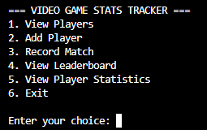
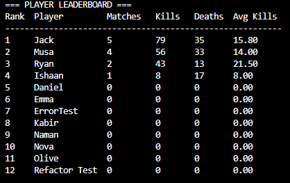
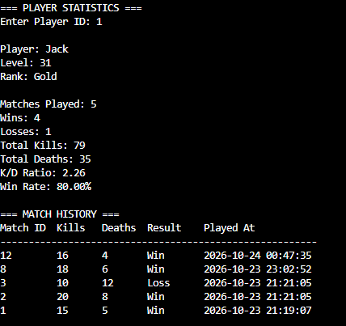

# Video Game Stats Tracker

A Python-based command-line application for recording, managing, and analyzing video game player statistics using SQLite.

The application allows users to register players, record match results, track individual performance, and compare players through a leaderboard.

**Status:** Functional CLI application | 27 automated tests passing

## Features

- **Player Management:** Register new players and view existing player profiles.
- **Match Tracking:** Record kills, deaths, and match outcomes for individual players.
- **Leaderboard:** Rank players by total kills and display match statistics.
- **Player Statistics:** Calculate win rates, kill/death ratios, and overall performance.
- **Match History:** Review previous matches for each player.
- **Data Persistence:** Store player and match information in a SQLite database.
- **Input Validation:** Handle invalid user input and database constraint violations.
- **Automated Testing:** Verify application behavior using Python's unittest framework.


## Screenshots

### Main Menu

The command-line interface provides access to all player and match management features.



### Player Leaderboard

The leaderboard ranks players by total kills and displays their overall match statistics.



### Player Statistics

Individual player profiles include win rate, kill/death ratio, and match history.



## Technologies Used

- **Python:** Application logic and command-line interface.
- **SQLite:** Relational database for storing player and match records.
- **SQL:** Database queries, joins, aggregations, and sorting.
- **unittest:** Automated testing with isolated in-memory databases.
- **Git and GitHub:** Version control and project hosting.

## Installation

### Prerequisites

- Python 3.10 or newer
- Git (for cloning the repository)

No external Python packages are required. The application uses Python's built-in `sqlite3` module.

### Setup

1. Clone the repository:

   ```bash
   git clone https://github.com/YOUR-USERNAME/video-game-stats-tracker.git
   ```

2. Navigate to the project directory:

   ```bash
   cd video-game-stats-tracker
   ```

3. Run the application:

   **Windows:**

   ```bash
   py main.py
   ```

   **macOS/Linux:**

   ```bash
   python3 main.py
   ```

The application automatically creates `game_stats.db` and initializes the required tables if they do not already exist.

## Usage

When the application starts, the following menu appears:

```text
=== VIDEO GAME STATS TRACKER ===

1. View Players
2. Add Player
3. Record Match
4. View Leaderboard
5. View Player Statistics
6. Exit
```

### Adding a Player

Select option `2` and enter a username and starting level.

Example:

```text
Enter username: Jack
Enter starting level: 20

Player 'Jack' added successfully!
```

### Recording a Match

Select option `3` and provide the player's ID, kills, deaths, and match result.

Example:

```text
Enter Player ID: 1
Enter kills: 20
Enter deaths: 5
Enter result (Win/Loss): Win

Match recorded successfully for Jack!
```

### Viewing the Leaderboard

Select option `4` to view players ranked by total kills.

The leaderboard includes:

- Matches played
- Total kills
- Total deaths
- Average kills per match

### Viewing Player Statistics

Select option `5` and enter a player ID.

The application displays:

- Player level and rank
- Total matches played
- Wins and losses
- Total kills and deaths
- Kill/death ratio
- Win rate
- Match history

## Project Architecture

The application separates its command-line interface, database operations, and automated tests into distinct components.

### Application Components

- **main.py:** Provides the command-line menu, manages the SQLite connection, and handles application navigation.
- **database.py:** Contains player management, match insertion, database queries, leaderboard calculations, and player statistics functions.
- **game_stats.db:** Stores persistent player and match records using SQLite.
- **tests/:** Contains automated tests that validate database operations and application logic using isolated in-memory SQLite databases.

### Database Design

The application uses two relational tables:

**players**
- player_id (Primary Key)
- username
- level
- rank

**matches**
- match_id (Primary Key)
- player_id (Foreign Key)
- kills
- deaths
- result
- played_at

Each player can have multiple matches, establishing a one-to-many relationship between the players and matches tables.

Foreign-key constraints prevent matches from referencing nonexistent players.

### Testing Strategy

The project uses Python's built-in unittest framework.

Each database test creates an isolated in-memory SQLite database using setUp() and closes the connection using tearDown().

The automated test suite verifies:
- Successful and failed player insertions
- Match insertion and foreign-key constraints
- Database retrieval and ordering
- Leaderboard calculations
- Player statistics and match history
- Empty database and zero-death edge cases

All 27 automated tests can be executed from the project root.

## Running Tests

Run the automated test suite from the project root:

```bash
python -m unittest discover -s tests -p "test_*.py" -t . -v
```

On Windows, you can use `py` instead of `python`.

The project includes 27 automated tests covering database operations, constraints, leaderboard calculations, player statistics, and edge cases.


## Future Improvements

Potential enhancements include:

- **Graphical User Interface:** Develop a desktop or web interface to replace the command-line menu.
- **Data Visualization:** Display player performance trends using charts and graphs.
- **Advanced Analytics:** Track performance over time and calculate additional player statistics.
- **Player Search and Filtering:** Allow users to search for players and filter match history.
- **CSV Export:** Export player statistics and match records for external analysis.
- **Expanded Testing:** Add automated tests for user input handling and multi-step database transactions.
